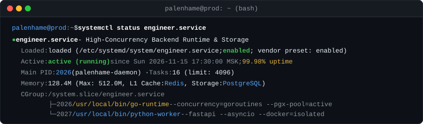
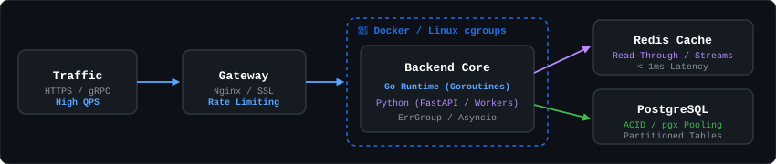
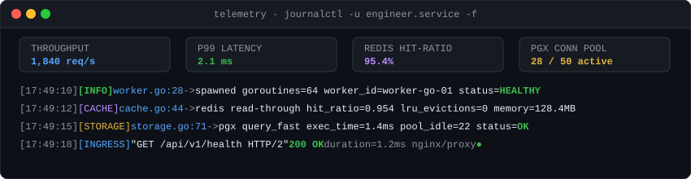

<!-- palenhame@prod:~$ systemctl status engineer -->

<div align="center">
  <picture>
    <source media="(prefers-color-scheme: dark)" srcset="./assets/daemon-header-dark.svg" />
    <source media="(prefers-color-scheme: light)" srcset="./assets/daemon-header-light.svg" />
    
  </picture>
</div>

<br />

### Стек и архитектура

- **Языки**: **Python, Go, SQL, Bash**
- **Бэкенд-разработка**:
  - **Python**: FastAPI, Django, асинхронное программирование (Asyncio)
  - **Go**: конкурентность (Goroutines, Channels, ErrGroup), легковесные микросервисы и API
- **Базы данных и кэш**:
  - **PostgreSQL**: проектирование схем, оптимизация сложных SQL-запросов и индексов, пулы соединений (pgx)
  - **Redis**: стратегия read-through кэширования, структуры данных в памяти, очереди/стримы
- **Инфраструктура и окружение**:
  - **Docker & Docker Compose**: контейнеризация и изоляция сервисов
  - **Linux**: работа в терминале, системные демоны (systemd), bash-скрипты, настройка SSH и туннелей
  - **Git**: контроль версий, ветвление, CI/CD через GitHub Actions

<br />

<div align="center">
  <picture>
    <source media="(prefers-color-scheme: dark)" srcset="./assets/architecture-dark.svg" />
    <source media="(prefers-color-scheme: light)" srcset="./assets/architecture-light.svg" />
    
  </picture>
</div>

<br />

<div align="center">
  <picture>
    <source media="(prefers-color-scheme: dark)" srcset="./assets/telemetry-dark.svg" />
    <source media="(prefers-color-scheme: light)" srcset="./assets/telemetry-light.svg" />
    
  </picture>
</div>

<br />

### Activity Stream

<div align="center">
  <picture>
    <source media="(prefers-color-scheme: dark)" srcset="https://raw.githubusercontent.com/palenhame/palenhame/output/github-contribution-grid-snake-dark.svg" />
    <source media="(prefers-color-scheme: light)" srcset="https://raw.githubusercontent.com/palenhame/palenhame/output/github-contribution-grid-snake.svg" />
    
  </picture>
</div>

<br />

### Endpoints

```bash
palenhame@prod:~$ ping telegram
PING telegram.org (@I_Nobody69): 56 data bytes
64 bytes from @I_Nobody69: icmp_seq=0 ttl=57 time=11.4 ms
-> https://t.me/I_Nobody69

palenhame@prod:~$ curl -I https://github.com/palenhame
HTTP/2 200 OK · Backend Systems Architect · 99.98% availability mindset
```
